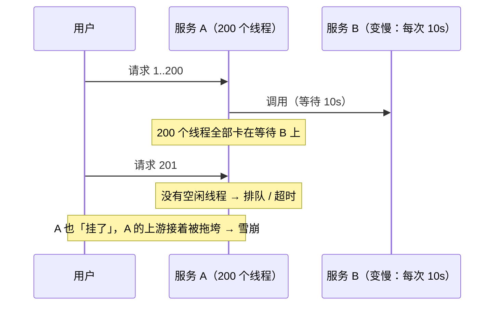
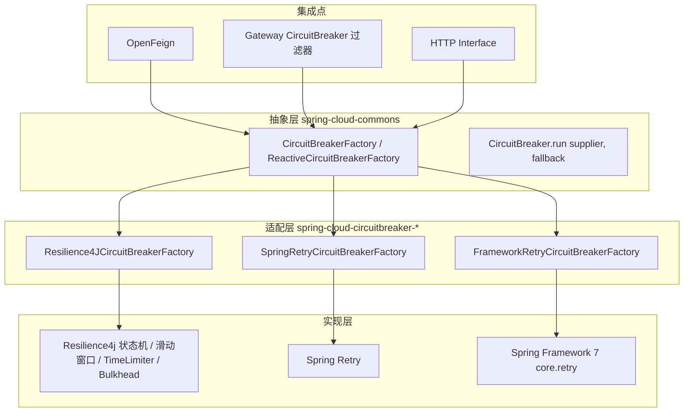

# 00. 全景：容错模式与 Spring Cloud CircuitBreaker

> 读完能回答：熔断在整个容错体系中处于什么位置？Spring Cloud CircuitBreaker 的分层结构是什么？和 Hystrix、Sentinel 有什么区别？

## 要解决的问题

微服务调用链中，任何一个下游变慢或故障，都可能沿调用链向上传导：



## 五种容错模式

| 模式 | 解决什么 | 本项目中的位置 |
|---|---|---|
| **超时**（Timeout） | 不无限等待 | L1-03 |
| **重试**（Retry） | 瞬时故障自愈 | L2-06、L3-04 |
| **熔断**（Circuit Breaker） | 下游持续故障时快速失败，给下游恢复的时间 | L1、L3-01 |
| **舱壁**（Bulkhead） | 限制对某个下游的并发，防止一个慢依赖耗尽全部资源 | L2-02、L4-03 |
| **降级**（Fallback） | 失败时返回兜底结果 | 贯穿全部模块 |

它们通常组合使用，组合顺序很重要（[03-decorator-order.md](03-decorator-order.md)）。

## Spring Cloud CircuitBreaker 的三层结构



- 抽象层只统一了**调用方式**，没有统一**行为**（L2-06 的实测对比）。
- 价值在于集成点统一：OpenFeign、Gateway、HTTP Interface 只依赖抽象，不用分别适配每一种实现。

## 与其他方案对比

| | Hystrix | Resilience4j | Sentinel |
|---|---|---|---|
| 状态 | 2018 年起停止维护 | 活跃 | 活跃 |
| 设计 | 命令模式（继承 HystrixCommand），强制线程池隔离 | 函数式装饰器，按需组合 | 资源 + 规则，控制台动态下发 |
| 隔离 | 线程池 / 信号量 | 线程池 / 信号量舱壁 | 并发线程数 |
| 熔断依据 | 错误率 | 失败率、慢调用比例 | 慢调用比例、异常比例、异常数 |
| 流控 | 无 | RateLimiter（单机） | 强项：QPS / 并发 / 热点参数 / 集群流控 |
| 动态规则 | Archaius | 需要自己实现（L4-04） | 控制台 + 配置中心推送 |
| Spring Cloud 集成 | spring-cloud-netflix（已移除） | spring-cloud-circuitbreaker-resilience4j | spring-cloud-alibaba-sentinel |

选型建议：只需要熔断、舱壁、超时、重试 → Resilience4j；需要流控（尤其是热点参数、集群流控）和可视化的动态规则 → Sentinel。

## 本项目的学习路线

```
L1 怎么用      → L2 怎么集成       → L3 为什么这样工作      → L4 怎么上生产
CircuitBreaker   Reactive / Feign /   手写状态机 / 滑动窗口 /   参数调优 / 监控告警 /
Factory / 配置   Gateway / 舱壁 / 指标  线程模型 / 组合顺序       分层保护 / 运维开关
```
