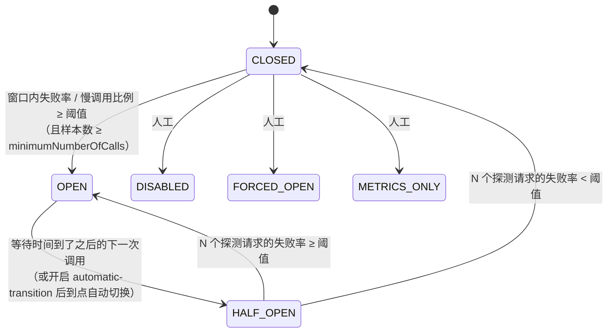

# 01. 熔断器状态机

> 相关模块：[L1-01](../level1-basic/01-circuitbreaker-factory)、[L3-01](../level3-principle/01-mini-circuitbreaker)、[L4-04](../level4-production/04-ops-switch)
> 读完能回答：每个状态下请求怎样处理？状态在什么时候、由什么触发切换？

## 要解决的问题

「下游坏了就不调用」听起来很简单，难点在于：怎样判断「坏了」？不调用之后，又怎样知道它「好了」？

## 核心流程

| 状态 | 是否放行 | 是否统计 | 状态私有的数据 |
|---|---|---|---|
| CLOSED | 是 | 是 | 大小为 slidingWindowSize 的滑动窗口 |
| OPEN | 否（抛出 CallNotPermittedException） | 否 | 可以重试的时间点 |
| HALF_OPEN | 前 N 个放行，其余拒绝 | 是（新窗口） | 剩余探测名额 + 大小为 N 的窗口 |
| DISABLED / FORCED_OPEN / METRICS_ONLY | 见 [L4-04](../level4-production/04-ops-switch/README.md) | | |

## 关键源码导读（Resilience4j 2.3）

| 类 / 方法 | 作用 |
|---|---|
| `CircuitBreakerStateMachine` | 状态机本体，`AtomicReference<CircuitBreakerState> stateReference` |
| `CircuitBreakerStateMachine#tryAcquirePermission` | 委托给当前状态对象 |
| `ClosedState#onError` → `checkIfThresholdsExceeded` | 记录结果，超过阈值时 `transitionToOpenState()` |
| `OpenState#tryAcquirePermission` | 检查 `clock.instant()` 是否过了 `retryAfterWaitDuration`，过了就切换为 HALF_OPEN |
| `HalfOpenState#tryAcquirePermission` | `permittedNumberOfCalls.getAndUpdate(...)` 递减探测名额 |
| `HalfOpenState#checkIfThresholdsExceeded` | 所有探测结果都回来之后才做判断 |

建议断点：`CircuitBreakerStateMachine#stateTransition`，观察每一次切换的调用栈。

## 设计取舍

- **为什么默认不自动切换为 HALF_OPEN**：自动切换需要额外的调度线程，而且没有流量时切换过去也没有意义。代价是没有流量时，看到的状态会一直是 OPEN（看板上容易误解）。
- **为什么要有 minimumNumberOfCalls**：避免「刚启动时 1 次调用失败 = 失败率 100%」就熔断。
- **为什么 HALF_OPEN 要等所有探测结果**：只凭第一个结果判断，容易被偶然的失败或成功误导。
- **为什么状态切换时丢弃旧窗口**：从 HALF_OPEN 恢复到 CLOSED 后，故障期间的失败数据已经没有参考价值。

## 和示例代码的对应

[MiniCircuitBreaker](../level3-principle/01-mini-circuitbreaker/src/main/java/com/kai/learn/cbdemo/l3/mini/MiniCircuitBreaker.java) 的简化：

- 用 `synchronized` 代替 `AtomicReference` + CAS（易读，但高并发下有锁竞争）
- 只实现了 COUNT_BASED 窗口，没有慢调用统计
- 没有三个特殊状态、没有事件发布

这些简化不影响核心状态机的行为，由 `CompareWithResilience4jTest` 验证（5 个随机种子 × 2000 步完全一致）。

## 常见问题

OPEN 状态下没有流量，看板上一直显示 OPEN，是不是熔断器坏了？

不是。默认 `automatic-transition-from-open-to-half-open-enabled: false`，切换由下一次调用触发。有流量进来时会立即切换为 HALF_OPEN。

HALF_OPEN 时，除了探测请求之外的其他请求会怎样？

被拒绝（CallNotPermittedException），和 OPEN 时一样。所以 HALF_OPEN 期间大部分请求仍然在走降级。

