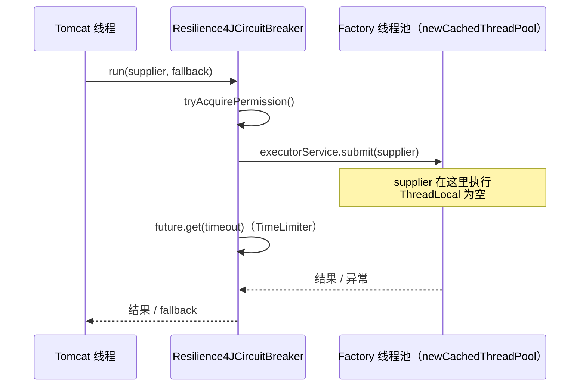

# 04. 线程模型与上下文传递

> 相关模块：[L1-03](../level1-basic/03-timelimiter-fallback)、[L2-02](../level2-advanced/02-bulkhead)、[L3-03](../level3-principle/03-factory-source)
> 读完能回答：`run()` 中的代码运行在哪个线程上？为什么？会带来什么问题，怎样修复？

## 要解决的问题

线上常见的现象：熔断保护的那一段代码，日志中没有 traceId；拿不到当前登录用户；`@Transactional` 不生效。
根源是这段代码**运行在另一个线程上**，而这些上下文都绑定在线程（ThreadLocal）上。

## 核心流程

为什么要切换线程：TimeLimiter 需要一个 Future 才能实现 `get(timeout)`。

## 四个分支（源码 `Resilience4JCircuitBreaker#run`）

| | 有 executorService（默认） | 无（disable-thread-pool=true） |
|---|---|---|
| 有舱壁 | CB( Bulkhead( TimeLimiter( submit ) ) ) | CB( Bulkhead( toRun ) ) |
| 无舱壁 | CB( TimeLimiter( submit ) ) | CB( toRun ) |

- 线程池舱壁 + 默认配置：**一次调用占用两个线程**（舱壁线程等待 Factory 线程池，L2-02 实测）。
- disable-thread-pool：不切换线程，但 **TimeLimiter 失效**，而且没有任何警告（L3-03 实测：配置 300ms，实际耗时 813ms 正常返回）。

## 修复方案

| 方案 | 做法 | 代价 |
|---|---|---|
| 搬运上下文（推荐） | `configureExecutorService` + `configureGroupExecutorService` 替换为会搬运上下文的线程池（[ContextPropagatingExecutorService](../level3-principle/03-factory-source/src/main/java/com/kai/learn/cbdemo/l3/source/ContextPropagatingExecutorService.java)） | 需要知道有哪些上下文；生产环境用 Micrometer context-propagation 自动处理 |
| 关闭线程池 | `disable-thread-pool: true` | TimeLimiter 失效，必须依靠 HTTP 客户端超时 |
| 响应式 | 使用 ReactiveCircuitBreakerFactory | 整个链路要是响应式的，上下文改用 Reactor Context |

搬运上下文的三个要点：在**调用方线程**上拍快照；在工作线程上恢复；在 **finally** 中清理（线程会被复用）。

## 常见问题

开启了虚拟线程，Factory 的线程池会变成虚拟线程吗？

不会。`Executors.newCachedThreadPool()` 是硬编码的。需要自己 `configureExecutorService(Executors.newVirtualThreadPerTaskExecutor())`（同样要包装上下文传递）。

run() 中的数据库操作能参与外层的事务吗？

不能。Spring 的事务绑定在线程上（TransactionSynchronizationManager 是 ThreadLocal）。
熔断保护的应该是远程调用，不要把数据库事务放进 run() 中。

