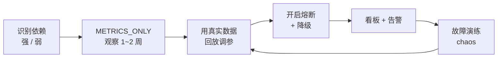

# 05. 生产实践：参数、超时预算与落地流程

> 相关模块：[L4-01](../level4-production/01-tuning-simulator) ~ [L4-04](../level4-production/04-ops-switch)
> 读完能回答：参数怎么定？超时怎么分配？怎样安全地在线上落地熔断？

## 参数怎么定

调参是在两个指标之间平衡（L4-01）：

- **误熔断**：下游健康时打开 → 正常请求被拒绝
- **发现延迟**：下游故障时迟迟不打开 → 请求在等待超时、线程被占用

| 参数 | 起步值 | 依据 |
|---|---|---|
| sliding-window-type | TIME_BASED | QPS > 10 时更稳定（[02-sliding-window.md](02-sliding-window.md)） |
| sliding-window-size | 10s | 越大越稳定，越小越灵敏 |
| minimum-number-of-calls | 窗口内正常流量的 20%~50% | 低流量时防止误判 |
| failure-rate-threshold | 50% | 正常失败率的 5~10 倍；发现延迟 ≈ W × t / f |
| slow-call-duration-threshold | 下游 P99 的 2~3 倍，且小于超时时间 | 在超时之前发现「变慢」 |
| wait-duration-in-open-state | 5~30s | 给下游恢复的时间；可以开启指数退避 |
| permitted-number-of-calls-in-half-open-state | 5~10 | 太少容易误判恢复 |
| ignore-exceptions | 4xx、业务异常、BulkheadFullException | 只统计「下游不健康」的信号 |

## 超时预算

```
客户端 10s > 网关 5s > 服务总超时 3s > 单个依赖 1s（强）/ 300ms（弱）
HTTP 读超时 ≤ TimeLimiter 超时
```

内层超时必须小于外层；TimeLimiter 只负责让调用方不再等待，真正释放资源的是 HTTP 客户端的超时（L1-03）。

## 落地流程



1. **识别强弱依赖**（L4-03）：弱依赖用舱壁 + 短超时 + 降级；强依赖用熔断 + 快速失败。
2. **先观察**：METRICS_ONLY 状态（L4-04）只统计不拦截，拿到真实的失败率分布。
3. **回放调参**：用 L4-01 的方法，把线上调用日志回放到不同的参数组上。
4. **上线**：配好降级逻辑（区分「熔断中」「超时」「下游 5xx」，L1-03），配好事件告警（L2-05）。
5. **看板 + 告警**（L4-02）：告警「持续打开」和「频繁抖动」，而不是每次打开都告警。
6. **故障演练**：定期在测试环境用本项目 cbdemo-downstream 这样的故障注入工具验证。

## 常见问题

<details>
<summary>多实例部署时，每个实例的熔断器是独立的吗？</summary>

是的，熔断器是单机的。10 个实例各自统计、各自打开。这通常是期望的行为（每个实例对下游的「体感」可能不同），
但人工干预（L4-04）和动态调参需要对所有实例生效，要通过配置中心广播。需要集群维度的流控时，考虑 Sentinel 的集群流控。
</details>
